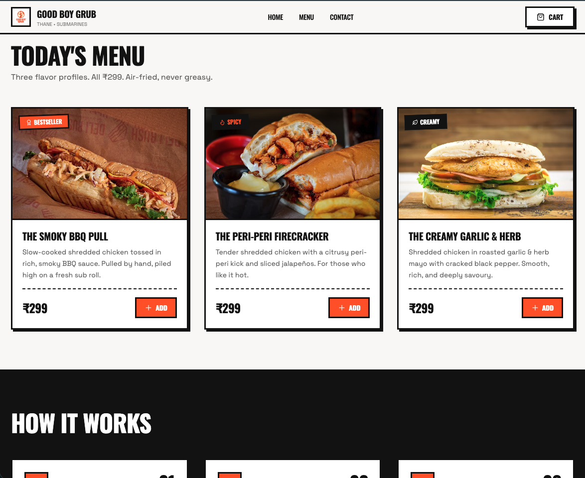
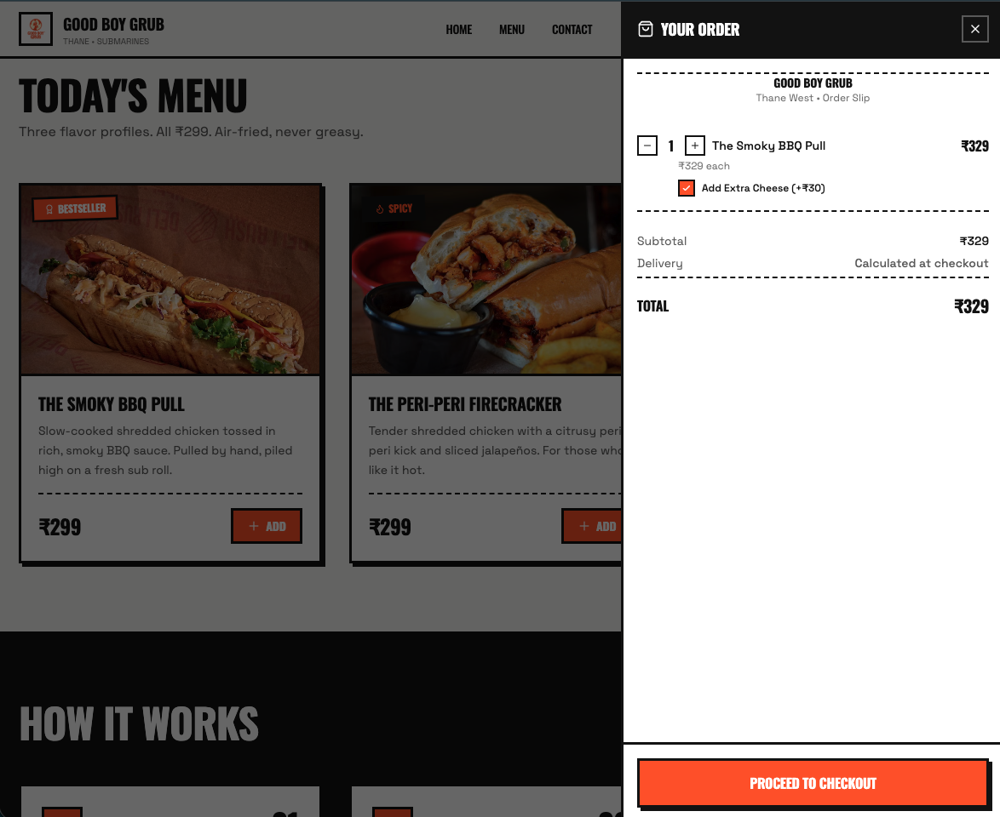
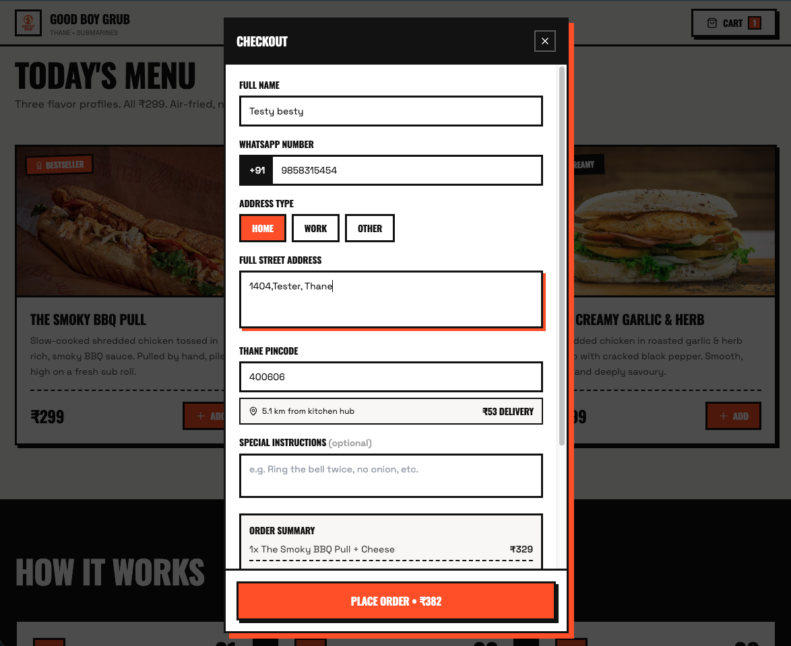
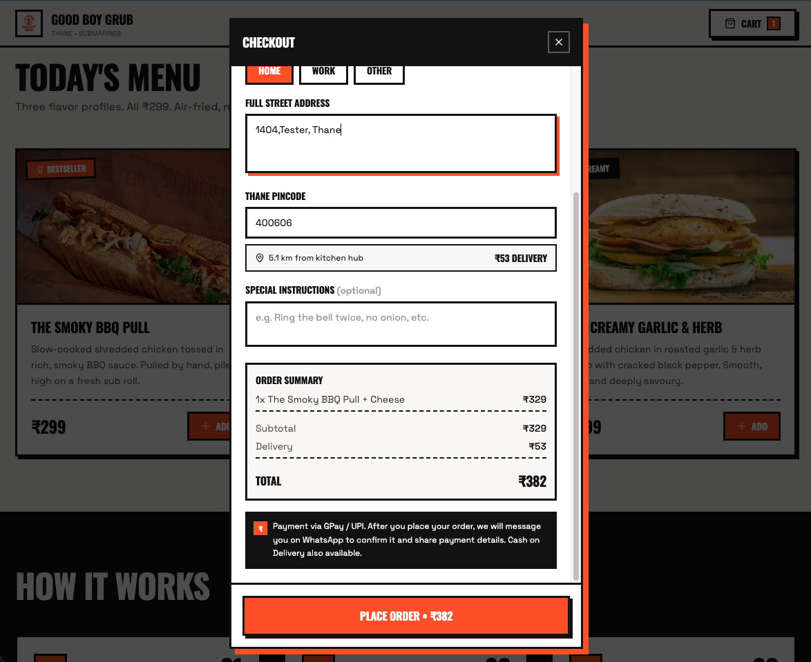
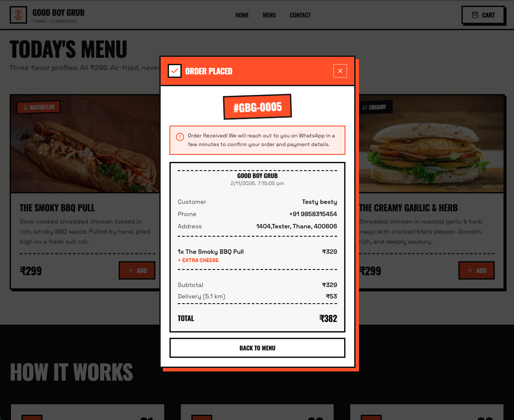
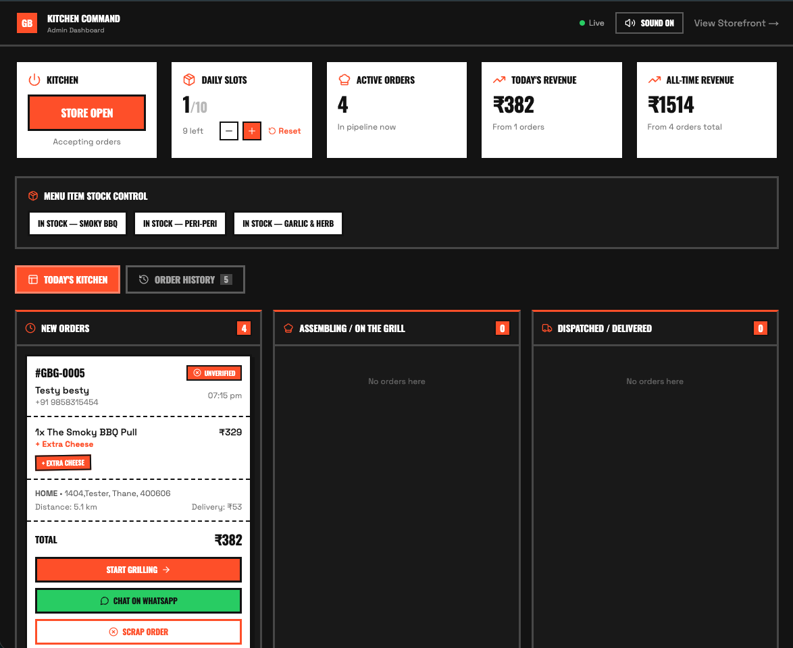

# Good Boy Grub 🍔

A modern online food-ordering platform built for a local food business in Thane, Maharashtra. Customers can browse the menu, customise their orders, and place orders online, while kitchen staff manage incoming orders through an admin dashboard.

**[Live Demo](https://goodboygrub.vercel.app)**

## Features

- **Online Menu:** Browse food items, view prices and customise orders with add-ons.
- **Shopping Cart:** Add, remove and manage items before checkout.
- **Guest Checkout:** Place orders without creating an account.
- **Order Management:** Kitchen staff can view and manage incoming orders through a dashboard.
- **Kitchen Display System:** Track orders across New, Preparing, Dispatched and Delivered stages.
- **Live Updates:** Supabase Realtime keeps order and kitchen information synchronised.
- **Store Controls:** Manage availability, daily order limits and sold-out items.
- **WhatsApp Confirmation:** Customers can confirm their orders through WhatsApp.

## Tech Stack

| Technology   | Purpose                                   |
| ------------ | ----------------------------------------- |
| Next.js      | Application framework                     |
| React        | User interface                            |
| TypeScript   | Type safety                               |
| Tailwind CSS | Styling and responsive layouts            |
| Supabase     | PostgreSQL database and real-time updates |
| Resend       | Email notifications                       |
| Vercel       | Deployment                                |
| Git & GitHub | Version control                           |

## Screenshots

### Storefront



### Shopping Cart



### Order Cart




### Ticket



### Kitchen Dashboard



## Getting Started

### Prerequisites

- Node.js 18+
- npm
- A Supabase project (optional for local demo mode)

### Installation

```bash
git clone YOUR_REPOSITORY_URL
cd good-boy-grub
npm install
npm run dev
```

Open [http://localhost:3000](http://localhost:3000) to view the application.

### Environment Variables

Create a `.env.local` file in the project root:

```env
NEXT_PUBLIC_SUPABASE_URL=your_supabase_project_url
NEXT_PUBLIC_SUPABASE_ANON_KEY=your_supabase_anon_key
RESEND_API_KEY=your_resend_api_key
```

Supabase is used for persistent order storage and real-time updates. Resend is optional for kitchen email notifications.

## Project Structure

```text
good-boy-grub/
├── app/
│   ├── admin/          # Kitchen dashboard
│   ├── api/            # API routes
│   ├── globals.css     # Global styles
│   ├── layout.tsx      # Root layout
│   └── page.tsx        # Customer storefront
├── components/         # Reusable UI components
├── lib/                # Application logic and integrations
├── supabase/           # Database schema and migrations
├── public/             # Static assets
└── README.md
```

## Available Scripts

| Command             | Description              |
| ------------------- | ------------------------ |
| `npm run dev`       | Start development server |
| `npm run build`     | Build for production     |
| `npm run start`     | Run production build     |
| `npm run lint`      | Run ESLint               |
| `npm run typecheck` | Check TypeScript types   |

## Future Improvements

- Stronger authentication and admin access controls
- Server-side order validation
- Improved order tracking
- Online payment integration
- Automated testing

---

**Note:** This project was developed as an online ordering solution for a local food business. Some implementation decisions and features may evolve as the application is improved.
